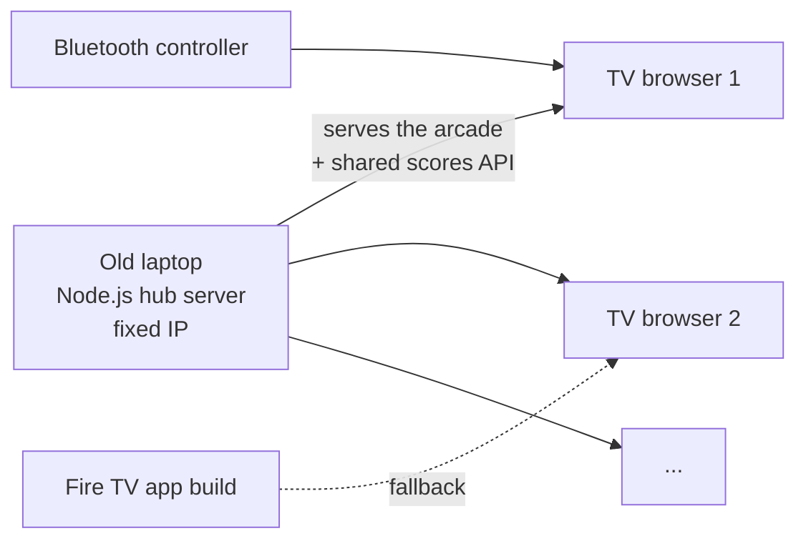

# Janitor Arcade

> A retro arcade of five controller games (single player and 2-player versus) that runs on any office TV with a Bluetooth controller. One old laptop on the office network hosts it for every TV, with a shared high-score board.

**When:** September – October 2026
**Stack:** HTML5 Canvas · vanilla JavaScript · Node.js (lobby hub server) · Gamepad API · Android / Fire TV wrapper (Java, built without Gradle) · PowerShell setup scripts
**My role:** Game design and direction, playtesting, and the network setup. Built with Claude Code as an AI pair programmer.

> Made as a fun branded arcade for my workplace, so the repository stays private. This page describes it and how it's built.

---

## The games

| Game | Type |
|---|---|
| Jimmy's Big Clean | Side-scrolling platformer with two original levels and a secret toilet warp |
| Mess Blaster | Top-down twin-stick shooter, endless waves, a boss every 5th wave |
| Floor Buffer Kart | Behind-the-kart pseudo-3D racer with items, ramps and 5 CPU rivals |
| Mop Wars | 1P vs CPU or 2P head to head: mop the most floor in your color |
| Plunger Party | 4 janitors in a maze; 1P vs 3 CPUs or 2P + 2 CPUs, best of 3 |

Arcade shell: game menu carousel, attract mode when idle (silent, so it doesn't bother the front desk), pause, initials entry and top-10 boards, with separate 1-player and 2-player boards for the versus games.

## How it's set up

- A one-time PowerShell script sets up the hub laptop: opens the firewall port, starts the hub at boot and keeps the laptop awake. The laptop gets a fixed IP in the UniFi controller.
- Any TV opens the hub's address in its web browser and becomes an arcade cabinet. No cloud and no app store.
- A controller test page confirms a new TV sees the Bluetooth controller.
- Fallback: an Android/Fire TV app built **without Gradle** and installed over Wi-Fi with a script.
- Input: Bluetooth gamepad, Fire TV remote or keyboard (two players can share a keyboard).

## Testing

A headless harness with **162 automated checks**, including bot playthroughs: bots finish the platformer, survive shooter waves, win kart races, and play CPU-vs-CPU matches of both versus games.

## Problems I found and fixed

- Platformer controls reworked after my playtest (duck, a dedicated shoot button)
- Karts stuck re-crashing into the same obstacle every frame, pile-ups, and a place counter showing NaN
- A Windows path bug that would have left the Fire TV app on a black screen

---

*Shares its characters and sounds with [Jimmy the Janitor: Tower Defense](https://github.com/Matteoinfl/janitor-tower-defense). More projects on my [profile](https://github.com/Matteoinfl).*
